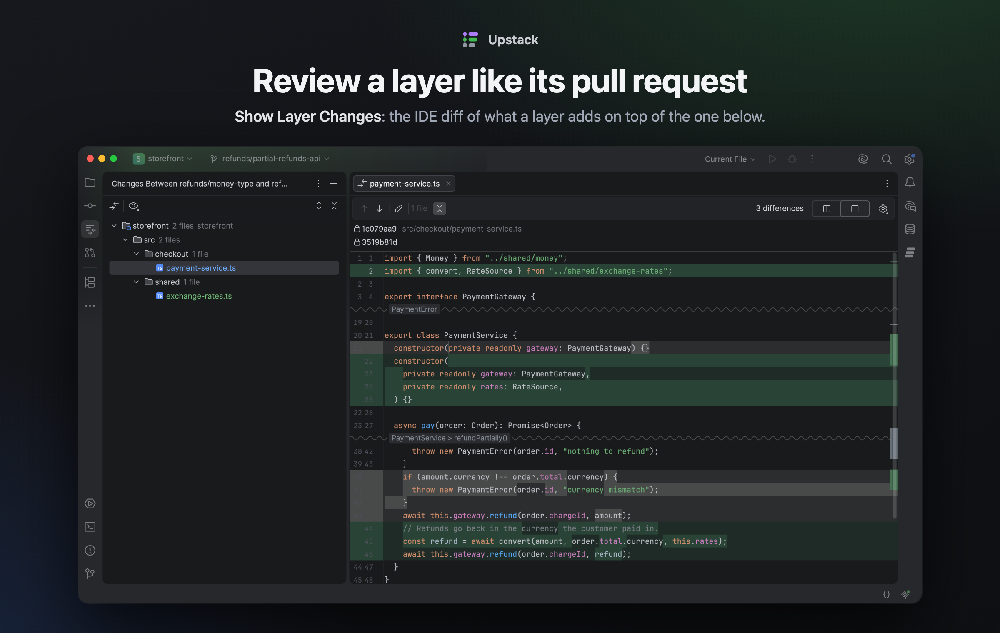

<div align="center">


# Upstack

**Stacked pull requests, in your IDE.**

A JetBrains plugin for GitHub stacked pull requests: the whole stack in a tool window, and
every button runs the same `gh stack` or `gh pr` command you would type. No account, no
server: it uses your own `gh` and its login.

[](#install)
[](https://github.com/github/gh-stack)
[](LICENSE)

[Install](#install) · [Feature tour](#feature-tour) · [Commands](#every-button-is-a-command) · [Full manual](docs/manual.md) · [Changelog](CHANGELOG.md)

</div>


## Why Upstack

Stacked pull requests split a big change into small layers: each one a branch with its own
pull request, on top of the one below. GitHub supports them with the
[`gh stack`](https://github.com/github/gh-stack) extension, but juggling five branches from
the terminal gets old fast: which layer am I on, which ones need a rebase, which pull request
is approved, why did the rebase stop.

- **The whole stack in one place**, with the state of every pull request, refreshed when git
  changes.
- **The terminal, with buttons.** Every action maps to a `gh stack`, `gh pr` or `git`
  command. Dialogs show it before running it, hovering shows it, and the Log tab keeps it
  with its output. Switch to the terminal at any point.
- **Rebase only what changed.** Carry a fix in a lower layer up the stack without fetching or
  touching the trunk.
- **Nothing in between.** It runs your `gh` with its login: no account, no token in the
  plugin, no server of its own.
- **Public APIs only.** The build fails if the Plugin Verifier finds any internal, deprecated
  or experimental API, so an IDE update shouldn't break it.

## Feature tour

### Every layer at a glance


- The stack as a graph, from the top layer down to the trunk. Per layer: branch, pull
  request number, draft or ready, title, size (`+120 −30`), labels, review decision and CI.
- What needs attention is marked: the layer you're on (*HEAD*), layers that **need a
  rebase**, a pull request whose base on GitHub isn't the layer below (**Wrong base**), and
  pull requests GitHub can't merge as they are (**Conflicts**, **Behind**).
- Hover a layer for its position in the stack, review, CI, files changed, labels and link.
  On top, a summary: `5 layers on main · 1 draft · 1 not published`.
- The data of every pull request in the stack comes in one GraphQL call, and it refreshes
  when git changes: branch, commits or refs.

### Start a stack, add layers


- **New Stack…**: type the layer names and see the resulting stack as a graph before
  anything runs. The base can be **any branch**, local or only on the remote, even a layer of
  another stack.
- **Add Layer…** on top, optionally committing your current changes in the new layer: all
  changes, tracked files only, or just what's staged. If you're not on the top layer, it
  checks it out first.
- Every dialog shows the exact `$ gh stack …` line it will run, live as you type.

### Publish the stack your way


- **Publish Stack…**: layer by layer, choose which pull requests end up **ready for review**
  and which stay **drafts**, and give the new ones a title (proposed from the branch name)
  and a description (from their commits).
- Or in one click: **as drafts** (`gh stack submit --auto`) or **ready for review**
  (`--open`, after showing which pull requests will change, because `--open` also marks
  existing drafts ready).
- **Publish a single layer** from its own menu, when no layer above it is unpublished.
- From each layer: **Mark Ready / Convert to Draft**, **Edit Title…**, **Labels…** and a
  **final-layer label** (`stack-final` by default, one per stack).

### Rebase only what changed


- Fix something in a lower layer and **Rebase Upstack**
  (`gh stack rebase --upstack --no-trunk`) carries it to the layers above **without fetching
  or rebasing onto the trunk**, so the only conflicts are the ones your change causes.
- It's offered right after you commit in the IDE on a layer that isn't the top (or it runs
  every time, if you choose so in the settings), from the *needs rebase* banner and from each
  layer's menu.
- The banner tells a layer behind the one below (rebase upstack) from a bottom layer behind
  the trunk (rebase the whole stack). The toolbar has the rest: whole stack, downstack and
  layers onto each other.
- After a rebase, a banner offers **Push Stack** (`gh stack push`) until the branches are
  pushed, from the IDE or from the terminal.
- The first rebase in a repository asks whether to turn on **`git rerere`**, as `gh stack`
  does in the terminal, and stores the answer in the same git config keys.

### Conflicts, guided


- When a rebase stops, **the IDE's conflicts dialog opens on its own**.
- The banner says which layer and which commit stopped, and how many files are still in
  conflict.
- When none is left, it turns blue and the next step is **Continue**
  (`gh stack rebase --continue`), one click.
- **Abort** asks first, because it also undoes the layers that were already rebased. The
  stack stays on screen during the rebase.

### Review a layer like its pull request



- **Show Layer Changes** opens the IDE diff with what a layer adds on top of the one below:
  the same changes its pull request shows. If the layer below moved on, it compares from
  their common commit, so new work below doesn't look as if the layer removed it.
- **Change Pull Request Base** points a *Wrong base* pull request back to the layer below
  (`gh pr edit <url> --base <branch>`).

### Merge or close the stack


- **Merge Stack…** and, from a layer, **Merge Up to Here…** use GitHub's atomic stack merge
  (`gh stack merge`): that pull request and every one below it are merged together, **or
  none is**.
- The dialog shows which layers go in, with their review and CI, and only the merge methods
  the repository allows, remembering the last one. With a **merge queue**, they join the
  queue.
- Before running it, it checks that the number isn't also a *stack* number, so it never
  merges the wrong thing. Afterwards, **Sync and Prune** (`gh stack sync --prune`) deletes
  the merged branches.
- **Close Stack…**: unstack it, close its open pull requests with an optional comment, and
  delete its remote and local branches, one checkbox each, in an order that never leaves a
  stack without branches. Local branches that differ from the remote are flagged and kept by
  default.

### Every option says what it runs


- **Hover anything** (toolbar buttons, menu items, banner buttons, dialog options) to see
  what it does **and the exact commands**, with your real branch and pull request.
- A layer's right-click menu holds only that layer's actions. Whole-stack actions say
  *Stack* and live in the toolbar and in the right-click outside the rows.
- The **Log** tab keeps every command it ran and its output.

### Set up in a minute


- **Check** (*Settings → Version Control → Upstack*) shows which `gh` is used and where, the
  account on each host, the `gh-stack` version, the repository's remotes and whether GitHub
  supports stacked pull requests there. Whatever is missing has its fix next to it:
  **Install**, **Upgrade gh-stack** or **Log In…**.
- **Log In without a terminal**: `gh auth login --web` gets a one-time code, and a dialog
  shows it, copies it and opens GitHub. The token stays with `gh`; Upstack never sees it.
- If `gh-stack` isn't v0.1.1, the version whose JSON and exit codes the plugin reads, it
  says so once. It blocks nothing.

### And also

- **When a branch goes missing**: a layer whose branch was deleted is marked *Branch
  deleted* (or *Only on origin*). **Restore Branch** brings it back from the remote or from
  its last known commit; **Remove From Stack…** takes it out.
- **Stacks whose branches are all gone**: **Forget Stack** stops tracking one without
  touching anything else, and **Recreate on Another Base…** starts the same layers again.
- **Delete Layer…** for the top layer without a pull request, and **Rename Branch…** for
  layers without one, here and on GitHub. Layers with a pull request can't be renamed:
  GitHub closes the pull request of a renamed branch.
- **A branch in several stacks** (a layer of one and the base of another): it says so and
  lists them all.
- **Several remotes**: it asks once which one to use and remembers it per project.
- **The Pull Requests tool window** gets a **Stack** menu in its list and details: ready /
  draft, labels, final-layer label and **Check Out Stack Locally**
  (`gh stack checkout <url>`).

## Install

- **Marketplace:** *Settings → Plugins → Marketplace*, search for **Upstack**.
- **From disk:** download the zip from
  [Releases](https://github.com/palmerovicdev/intellij-stacked-prs/releases) (or
  [build it](#building-from-source)), then *Settings → Plugins → ⚙ → Install Plugin from
  Disk…*

It needs:

- **IntelliJ IDEA 2026.2 or newer**, with the bundled Git plugin. The GitHub plugin is
  optional: only the *Pull Requests* menus use it.
- The [GitHub CLI](https://cli.github.com), signed in (`gh auth login`, or *Log In…* from
  the plugin).
- The `gh-stack` extension, v0.1.1 (`gh extension install github/gh-stack`). The plugin
  offers to install it if it's missing, and warns about any other version.
- A GitHub repository with stacked pull requests. *Check* tells you if it doesn't have them.

## Quick start

1. *Settings → Version Control → Upstack → Check*, and fix whatever it marks.
2. Open the **Stacks** tool window, on the right, and click **New Stack…**: name the layers,
   bottom to top.
3. Commit on each layer from the IDE as usual. **Add Layer…** puts a new one on top.
4. **Publish Stack…** pushes every layer and creates the pull requests, ready or draft.
5. Changed a lower layer? Accept **Rebase Upstack** after the commit, then **Push Stack**.
6. When it's approved, **Merge Stack…**, then **Sync and Prune**.

## Every button is a command

| Action | Command |
|---|---|
| New Stack… | `gh stack init [--base branch] layers…` |
| Add Layer… | `gh stack add branch` (`gh stack top` first if you're not on top; to commit, `-A` or `-u` and `-m`) |
| Publish Stack… | `gh stack submit --auto`, then `gh pr edit <branch> --title … --body …` for each new pull request and `gh pr ready` (or `--undo`) for each change |
| Publish as drafts / ready | `gh stack submit --auto` / `gh stack submit --auto --open` |
| Mark Ready / Convert to Draft | `gh pr ready <url>` / `gh pr ready <url> --undo` |
| Change Pull Request Base | `gh pr edit <url> --base <layer below>` |
| Show Layer Changes | the IDE diff, same as `git diff <layer below>...<layer>` |
| Labels…, final layer | `gh pr edit <url> --add-label … --remove-label …` |
| Edit Title… | `gh pr edit <url> --title …` |
| Sync / Rebase | `gh stack sync` / `gh stack rebase` (`--continue`, `--abort`) |
| Rebase Upstack | `gh stack rebase --upstack --no-trunk` |
| Other rebases | `gh stack rebase --downstack` and `gh stack rebase --no-trunk` |
| Push Stack | `gh stack push` |
| Merge Stack… | `gh stack merge <pr> --yes --squash` (or `--merge`, `--rebase`; no method with a merge queue) |
| Sync and Prune | `gh stack sync --prune` |
| Close Stack… | `gh stack unstack`, then `gh pr close <url>`, `git push origin --delete …` and `git branch -D …` |
| Restore Branch | `git branch <branch> <last commit>` or `git branch --track <branch> origin/<branch>` |
| Check | `gh --version`, `gh auth status --json hosts`, `gh stack --version` and `gh api repos/OWNER/REPO/stacks?per_page=1` (read only) |
| Log In… | `gh auth login --web --hostname <host>` |
| Upgrade gh-stack | `gh extension upgrade gh-stack` |

The full table, with *Delete Layer…* and *Rename Branch…*, is in the
[manual](docs/manual.md#qué-hace).

## Where your settings live

| Where | What | In version control |
|---|---|---|
| `upstack.xml`, in the IDE settings | The path to `gh`, the final-layer label and what to do after a commit on a lower layer | No |
| The project's `workspace.xml` | The repository and remote to use, and the last merge method | No |
| The repository's git config | Your `git rerere` answer, in the same keys `gh stack` uses | No |

The stacks themselves are `gh stack`'s: Upstack reads them with `gh stack view --json` and
stores nothing about them.

## Building from source

```bash
./gradlew test                  # unit and flow tests, with a fake gh and no network
./gradlew verifyPlugin          # the strict Plugin Verifier against the local IDE
./gradlew runIde -PrunIdeProject=/path/to/a/repo   # a sandbox IDE with that project
./gradlew buildPlugin           # -> build/distributions/upstack-<version>.zip
```

It compiles against the IDE that `localIdePath` in `gradle.properties` points to, so nothing
is downloaded; an empty `-PlocalIdePath=` downloads IntelliJ IDEA 2026.2.2, as CI does.
Requirements, the source layout, what has been verified and the release process are in
[`docs/development.md`](docs/development.md).

**Releasing:** bump `pluginVersion`, `changeNotes` and `CHANGELOG.md` in a pull request, add
the **`release`** label and merge it. The `vX.Y.Z` tag, the GitHub release with the zip and,
when the signing secrets are set, the Marketplace upload follow on their own.

## Documentation

The detailed docs are written in Spanish.

- [Manual](docs/manual.md): every feature and command in detail, and why it works the way it
  does
- [Development](docs/development.md): building, testing, what has been verified and releasing
- [Roadmap](docs/roadmap.md)
- [Marketplace and Reddit](docs/marketplace/README.md): the slides above and how to remake
  them
- [Changelog](CHANGELOG.md)

Bug reports and ideas are welcome in
[Issues](https://github.com/palmerovicdev/intellij-stacked-prs/issues).

## License

[MIT](LICENSE) © Victor Palmero
